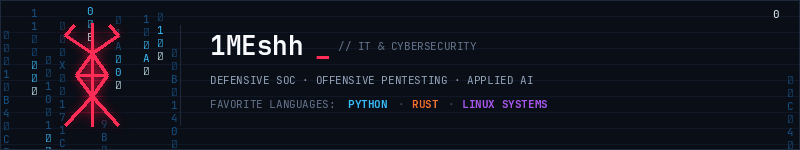

  

Interested in IT, cybersecurity, Linux systems, and applied AI.

I focus on both sides of security:
- **SOC & Defense:** Log analysis, detection rules (Sigma), memory forensics, and network inspection.
- **Pentesting & Research:** Vulnerability analysis, protocol security, honeypots, and tooling.

Most of what I build is in **Python** and **Rust**.

---

### Projects

#### Security
- [**Aegis**](https://github.com/1MEshh/Aegis) – Linux memory forensics and rootkit detection (C++20)
- [**Talon**](https://github.com/1MEshh/Talon) – Sigma rule engine and event detection compiler (Rust)
- [**Doom**](https://github.com/1MEshh/Doom) – Security tool with local model integration and shell generation (Rust)
- [**Mirage**](https://github.com/1MEshh/Mirage) – Honeypot daemon with shell deobfuscation and MITRE mapping (Python)
- [**Netpulse**](https://github.com/1MEshh/Netpulse) – PCAP packet analyzer and TLS JA3 fingerprinter (C++20)
- [**Sanitize**](https://github.com/1MEshh/Sanitize) – EXIF/GPS scrubber and sensitive data scanner (Python)
- [**Specter**](https://github.com/1MEshh/Specter) – JWT security analysis tool (Rust)
- [**Warden**](https://github.com/1MEshh/Warden) – Secret scanner and credential auditor (Python)

#### Linux & Tools
- [**Overdrive**](https://github.com/1MEshh/Overdrive) – Steam launch tool and frametime telemetry auditor (Rust)
- [**Barforge**](https://github.com/1MEshh/Barforge) – Waybar module daemon and CSS generator (Rust)
- [**Tracegrid**](https://github.com/1MEshh/Tracegrid) – Multipath traceroute and route diffing tool (Rust)
- [**Pacguard**](https://github.com/1MEshh/Pacguard) – Arch Linux PKGBUILD security auditor (Python)
- [**voiceGG**](https://github.com/1MEshh/voiceGG) – Low-latency audio processing tool for Linux (Rust)
- [**KeyCaster**](https://github.com/1MEshh/KeyCaster) – Bilingual typing practice tool (TypeScript)

---

### What I Use
- **Languages:** Python, Rust, C++, TypeScript, Bash soon(go,lua)
- **System:** Arch Linux / Wayland
- **Tools:** Wireshark, GDB, Docker, Git
